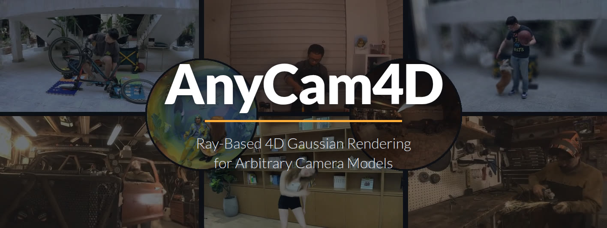

<h1 align="center">AnyCam4D: Ray-Based 4D Gaussian Rendering for Arbitrary Camera Models</h1>

<p align="center">
  <a href="https://sascha-kirch.github.io/">Sascha Kirch</a><sup>1</sup>, <a href="https://www.rafapages.com/">Rafael Pagés</a><sup>2</sup>, <a href="https://orcid.org/0000-0002-5409-1521">Jan Ondřej</a><sup>2</sup>, <a href="https://orcid.org/0000-0001-8260-4155">Clara Pérez-Molina</a><sup>1</sup>, <a href="https://orcid.org/0000-0002-4118-0234">Sergio Martin</a><sup>1</sup><br>
  <sup>1</sup>UNED, Universidad Nacional de Educación a Distancia, Madrid &nbsp; <sup>2</sup>Volograms, Dublin
</p>

<p align="center">
  <a href="https://arxiv.org/abs/2611.34223"></a>
  <a href="https://sascha-kirch.github.io/anycam4d/"></a>
  <a href="https://huggingface.co/datasets/sascha-kirch/dynopsis"></a>
  <a href="#citation"></a>
  <a href="LICENSE"></a>
</p>

<p align="center">
  
</p>

## Overview

AnyCam4D reconstructs dynamic scenes as 4D Gaussians and renders them through the camera that actually took the
images — pinhole, Brown–Conrady or wide-angle fisheye — without undistorting the data first. Each Gaussian is
conditioned to a 3D Gaussian at the requested time, projected through the lens with the unscented transform, and
rasterized by casting rays in world space. Because the camera only enters at projection, a trained model renders
through any lens, and through camera effects the training data never had: rolling shutter, thin-lens depth of field
and lateral chromatic aberration.

The repository contains the CUDA renderer (the AnyCam4D ray backend and an EWA splatting baseline), training with the
published 4DGS densifier and an MCMC alternative, evaluation in each camera's native image space, an interactive
viewer, and data preparation for DyNeRF, SelfCap, DeepView, the Dynopsis benchmark, and your own synchronized videos.

## Requirements

- Linux with an NVIDIA GPU and a driver for CUDA 12.8 or newer.
- [pixi](https://pixi.sh). Every dependency, including the CUDA toolkit, PyTorch 2.10 and COLMAP, comes from the
  pixi environment.

## Install

```bash
pixi install
pixi run setup        # builds gsplat, fused-ssim and fused-bilagrid against the installed PyTorch
pixi run test         # also compiles the AnyCam4D CUDA extension on first use (a few minutes)
```

CUDA code is compiled for the GPU visible at build time and cached per architecture. To build without a visible GPU,
or for several GPUs, name the architectures: `ANYCAM4D_CUDA_ARCH_LIST="8.6;8.9" pixi run setup`.
`pixi run cuda-rebuild` cleans and rebuilds the extension.

## Quick start

A five-minute check of the whole pipeline on the prepared Dynopsis fisheye set (short schedule, low quality):

```bash
pixi run download --registry conf/datasets/dynopsis.yaml --scene fisheye_kb --dest data/dynopsis
pixi run train --config-name anycam4d dataset.data_dir=data/dynopsis/scene1/fisheye_kb/count_32 \
    training.max_steps=300 strategy.refine_start_iter=100 strategy.refine_stop_iter=250 hydra.run.dir=runs/smoke
pixi run eval -c runs/smoke/checkpoints/last.pt
```

The densification window (`strategy.refine_start_iter`/`refine_stop_iter`, absolute steps) must fit inside
`training.max_steps`; training refuses to start otherwise.

## Data

Full guide: [`documentation/dataset_preparation.md`](documentation/dataset_preparation.md).

```bash
# Dynopsis ships prepared
pixi run download --registry conf/datasets/dynopsis.yaml --scene fisheye_kb --dest data/dynopsis

# Benchmarks: download the raw videos, then build (COLMAP calibration, frame extraction, variants)
pixi run download --registry conf/datasets/dynerf.yaml --scene flame_steak --dest ~/datasets/DyNeRF
pixi run build-dynerf --source-root ~/datasets/DyNeRF --out-root data/4dgs --scene flame_steak

# Your own rig: one synchronized video per camera
pixi run prepare-videos --videos path/to/videos --out data/my_scene --camera-model opencv --eval-cams 0
```

No third-party dataset is redistributed; `download` fetches each one from its original source and prints its licence.

## Train

```bash
# AnyCam4D, native lens
pixi run train --config-name anycam4d dataset.data_dir=data/4dgs/flame_steak_r2 hydra.run.dir=runs/flame_steak

# EWA splatting on undistorted pinhole images (the published 4DGS setting)
pixi run train --config-name 4dgs dataset.data_dir=data/4dgs/flame_steak_undistorted_r2 hydra.run.dir=runs/flame_steak_ewa
```

Configuration is [Hydra](https://hydra.cc). `conf/anycam4d.yaml` and `conf/4dgs.yaml` combine `conf/base.yaml` (the
settings every run shares), a densification `recipe` and a `rendering` backend (`anycam4d` or `ewa`); any field can be
overridden on the command line. Both train the published 4DGS densifier (`recipe=og_4dgs`), whose temporal learning
rate and initial temporal width depend on the sequence: `pixi run python scripts/og4dgs_regime.py <dataset>
--overrides` prints them as overrides. MCMC densification instead: `recipe=mcmc_spatial`. The live viewer during
training: `viewer.enabled=true`.

The published densifier does not cap the population, so GPU memory sets the limit: about 2.4 GB per million
Gaussians. Most scenes at half resolution (the `_r2` variants) fit on a 16 GB GPU; the largest SelfCap scenes need
more.

A run writes `checkpoints/best.pt` and `last.pt`, TensorBoard logs in `tb/` (losses, population, densification
events, and every evaluation broken down per frame and per camera), and `run_provenance.json` with the commit that
produced it.

## Evaluate

```bash
pixi run eval -c runs/flame_steak/checkpoints/best.pt
```

PSNR, SSIM, LPIPS and the two DSSIM variants published tables use, on the held-out cameras, scored in each camera's
native image space over the pixels it observed, plus PSNR and SSIM per incidence-angle band. `--rendering ewa` renders the same model through the other
backend; `--central_ref <undistorted dataset>` adds the central/peripheral split against a shared pinhole region.

## View and render

```bash
pixi run view runs/flame_steak/checkpoints/best.pt --backend anycam4d   # browser viewer with time slider and lens panel
```

Forward-only renders of a trained model through other cameras, in `scripts/render/`:

| Script | Output |
|---|---|
| `render_any_camera.py` | one pose and time through the dataset lens, a 90° pinhole and a 180° fisheye |
| `render_lens_morph.py` | video morphing the lens from pinhole to equidistant fisheye and back |
| `render_lens_grid.py` | grid of lenses from one pose |
| `render_rolling_shutter.py` | global and rolling shutter side by side, with camera and scene motion |
| `render_depth_of_field.py` | thin-lens depth of field, single image or rack focus |

Each takes `<checkpoint> <dataset> <output>`; `--help` lists the options. Lateral chromatic aberration is available
from Python as `anycam4d.renderer.chromatic_aberration`.

## Reproduce the paper

`scripts/reproduce/main_tables.sh` trains and evaluates every cell of the main comparison, EWA and AnyCam4D each on
undistorted pinholes and through the native lens (21 scenes, 3 seeds), with the per-scene settings of the paper. Build
the datasets with `--out-root $DATA_ROOT/<dataset>` (Dynopsis: `--dest $DATA_ROOT/dynopsis`) first; `DRY_RUN=1` prints
the commands (the datasets must exist), `SCENES` and `SEEDS` select a subset. `scripts/reproduce/fidelity_table.sh`
(same options) trains our EWA against the published 4DGS on DyNeRF, with additive temporal harmonics and selective Adam
each replaced by the published choice. The main-comparison runs feed the other scripts in `scripts/reproduce/`:

| Script | Result |
|---|---|
| `rotation_gt.py` | PSNR of rotated cameras against path-traced ground truth (Dynopsis set `rotated_gt`) |
| `rotation_consistency.py` | agreement of rotated views with a supersampled reference, on any dataset |
| `benchmark_cost.py` | render and render + backward latency, AnyCam4D against EWA |

The kernel-precision tables need neither data nor training:

```bash
pixi run pytest tests/bench_numerics.py -m bench -s
```

## Dataset format

A dataset is a directory with `train_dataset.json`, an optional `eval_dataset.json` (same schema, held-out captures),
the images, and an initial point cloud:

```text
my_scene/
├── train_dataset.json
├── eval_dataset.json
├── points3d.ply
├── images/cam00_0000.jpg …
└── valid/0.png …            optional per-camera masks of the pixels a camera observed (nonzero = observed)
```

- **Cameras** follow COLMAP/OpenCV conventions:

  | `model` | `params` |
  |---|---|
  | `pinhole` | fx, fy, cx, cy |
  | `opencv` | fx, fy, cx, cy, k1, k2, p1, p2, k3 |
  | `opencv_full` | fx, fy, cx, cy + up to 12 coefficients (rational, tangential, thin prism) |
  | `fisheye_equidistant` | fx, fy, cx, cy |
  | `fisheye_opencv` | fx, fy, cx, cy, k1, k2, k3, k4 (Kannala–Brandt) |

  A pinhole produced by undistortion carries a `reproject_source` block with the native lens (`model`, `width`,
  `height`, `params`); the loader replays the warp and excludes the pixels the source never covered.
- **Captures** are camera-to-world poses in the OpenCV camera frame (+x right, +y down, +z forward): `rotation` is a
  unit quaternion `[qw, qx, qy, qz]`, `translation` the camera centre. `timestamp` is in seconds and normalized to
  `[-0.5, 0.5]` over the sequence at load.
- **Frames.** `frame_id` groups the captures of one instant, and every frame must be seen by the same cameras. Each
  image is rendered at its own `timestamp`, so cameras may be offset in time within a frame; only
  `training.sampler=frame_aligned`, which renders a frame's cameras in one pass, needs them to share one.
- **Alpha.** An RGBA image's alpha is a foreground mask: background is supervised toward empty. It never encodes
  which pixels were observed; that comes from the camera model, `reproject_source`, or `valid/`.

```json
{
  "schema_version": 1,
  "metadata": {
    "world_coordinate_system": "right_handed",
    "camera_coordinate_system": "opencv",
    "transform_convention": "camera_to_world"
  },
  "pointcloud_path": "points3d.ply",
  "cameras": [
    {"camera_id": 0, "model": "opencv", "width": 1920, "height": 1080,
     "params": [1200.0, 1200.0, 960.0, 540.0, 0.01, -0.01, 0.0, 0.0, 0.0]},
    {"camera_id": 1, "model": "fisheye_opencv", "width": 1920, "height": 1080,
     "params": [950.0, 950.0, 960.0, 540.0, 0.01, -0.001, 0.0001, 0.00001]}
  ],
  "captures": [
    {"image_path": "images/cam00_0000.jpg", "camera_id": 0, "frame_id": 0, "timestamp": 0.0,
     "rotation": [1.0, 0.0, 0.0, 0.0], "translation": [0.0, 0.0, 0.0]},
    {"image_path": "images/cam01_0000.jpg", "camera_id": 1, "frame_id": 0, "timestamp": 0.0,
     "rotation": [1.0, 0.0, 0.0, 0.0], "translation": [0.1, 0.0, 0.0]},
    {"image_path": "images/cam00_0001.jpg", "camera_id": 0, "frame_id": 1, "timestamp": 0.0333333,
     "rotation": [1.0, 0.0, 0.0, 0.0], "translation": [0.0, 0.0, 0.0]},
    {"image_path": "images/cam01_0001.jpg", "camera_id": 1, "frame_id": 1, "timestamp": 0.0333333,
     "rotation": [1.0, 0.0, 0.0, 0.0], "translation": [0.1, 0.0, 0.0]}
  ]
}
```

## Adding a camera model

Every camera model belongs to a projection family, and the family fixes the CUDA code: the pinhole family evaluates
OpenCV's rational, tangential and thin-prism distortion with 12 coefficients, the fisheye family the Kannala–Brandt
polynomial with 4. Models within a family differ only in how many of those coefficients they use.

**A model inside an existing family** needs Python only:

1. A member of `CameraModelType` in `anycam4d/enums.py`; its value is the `model` string of the dataset manifest.
2. An entry in `CAMERA_REGISTRY` in `anycam4d/camera/registry.py`: family, number of distortion coefficients (a prefix
   of the family's OpenCV order) and the backends that render it.
3. If `prepare-videos` should calibrate it with COLMAP: its COLMAP model name in `COLMAP_MODEL`
   (`anycam4d/data/prep/importers/video_rig.py`) and the way back in `_COLMAP_MODEL_MAP`
   (`anycam4d/data/prep/colmap.py`).

**A new family** (a different projection) also needs:

1. A `ProjectionFamily` member with its id in `FAMILY_CUDA_ID` and its slot count in `FAMILY_N_SLOTS`
   (`anycam4d/camera/registry.py`), mirrored in `enum ProjectionFamily` (`anycam4d/cuda/csrc/common.h`). Every
   kernel launcher dispatches on the family with its own `switch (family)` and checks the slot count
   (`grep -n "switch (family)\|FISHEYE_FAMILY) ?" anycam4d/cuda/csrc/*`); each needs the new case. A mismatched id
   renders through the wrong lens without an error.
2. `CameraOps<F>` in `anycam4d/cuda/csrc/camera_ops.cuh`: `n_slots`, `project` (camera-space point to pixel),
   `unproject` (pixel to ray), `images_behind`, and for the tile box (`ut_4d.cuh`) `radial` (image radius of an
   incidence angle) and `offset_bound` (bound on the non-radial distortion offset). The tile box must contain every
   pixel the rasterizer draws; `tests/test_ut_projection.py` checks it.
3. The host side: the observable domain of the lens in `anycam4d/math/lens_domain.py` and `anycam4d/camera/validity.py`,
   the ray solve in `anycam4d/math/camera_rays.py`, and the undistortion in `anycam4d/data/prep/stages/to_pinhole.py`.
   The kernel's ray-validity gate must stay a subset of the host validity mask.
4. For EWA, the lens Jacobian `EwaLens<F>` in `anycam4d/cuda/csrc/ewa_4d_lens.cuh` and its limits in
   `ewa_4d_lens_limits.cuh`; otherwise leave EWA out of the model's backends.

The tests to extend are `test_camera_models.py` (registry and id mirror), `test_cuda_family_dispatch.py` (device
against host projection), `test_opencv_distortion.py` (against OpenCV, where OpenCV has the model),
`test_rasterize_world_valid_flag.py` (gate within validity) and `test_camera_rays.py`.

## Citation

```bibtex
@article{kirch2026anycam4d,
  title   = {AnyCam4D: Ray-Based 4D Gaussian Rendering for Arbitrary Camera Models},
  author  = {Kirch, Sascha and Pag{\'e}s, Rafael and Ond{\v{r}}ej, Jan and
             P{\'e}rez-Molina, Clara and Martin, Sergio},
  journal = {arXiv preprint arXiv:2611.34223},
  eprint  = {2611.34223},
  archivePrefix = {arXiv},
  year    = {2026}
}
```

## License

Apache License 2.0, see [`LICENSE`](LICENSE).
